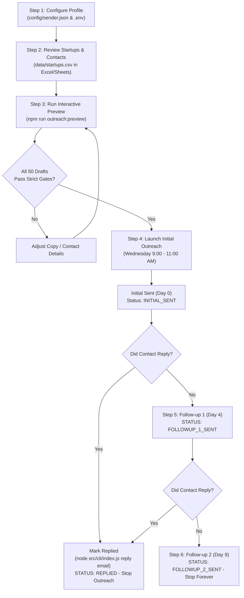

# Seed Startup Cold Outreach Engine: End-to-End Process Guide

> **"Job boards put you in a queue. This puts you in a conversation."**

---

## 1. Executive Summary & The Conversion Math

Traditional cold outreach typically achieves an average conversion of **8.5%** (~4 replies from 50 emails). By methodically stacking proven behavioral multipliers, this process lifts reply rates to **16% – 24%**:

```
 25 Target Startups
  x 2 Contacts (Founder + Tech Lead)
─────────────────────────────────────
= 50 Personalized Cold Emails
   │
   ├── Average Conversion (8.5%):  4 Replies
   ├── Multi-contact Lift (+93%):  +3.7 Replies
   ├── Personalized Body (+32.7%): +2.5 Replies
   ├── Day 4 Follow-Up (+65.8%):   +2.6 Replies
   └── Optimal Wed 9-11AM Timing
─────────────────────────────────────
= 8 to 12 Qualified Conversations
   └── 3 to 4 Technical Intro Calls
        └── 1 to 2 Job Offers
```

One focused weekend to build and review your target list puts you directly into conversations with founders before job posts ever go public.

---

## 2. The 6 Core Rules & The Science Behind Them

### Rule 1: Seed Round Raised 2 to 9 Months Ago
* **Why:** Fresh money equals hiring pressure.
* **Under 2 months:** Founders are still scrambling, setting up banking, and dealing with post-close legalities. Hiring processes are chaotic or paused.
* **Over 9 months:** Seed capital has largely been allocated or teams are already mid-flight towards Series A.
* **The Sweet Spot:** At 2 to 9 months, roadmaps are locked, seed capital is in the bank, and product velocity demands immediate technical bandwidth.
* **Sources:** [Inc42 Funding Tracker](https://inc42.com/track-funding-feed/), [Entrackr Funding Tracker](https://entrackr.com/funding/), and [Wellfound's Recently Funded Filter](https://wellfound.com).

### Rule 2: Keep Only Startups Under 30 People
* **Why:** At under 30 employees, there is no VP of People, Head of Talent, or automated ATS gatekeeper standing between you and the founder.
* **Direct Inbox Access:** Founders and founding technical leads at <30 headcount personally read, triage, and answer their own inboxes every single day.

### Rule 3: Reached 2 Contacts Per Startup (Founder + Functional Lead)
* **Why:** Reaching more than one decision maker lifts reply rates by **+93%**.
* **Contact 1 — The Founder / CEO:** Cares about product shipping velocity, runway, and eliminating technical bottlenecks that slow the business.
* **Contact 2 — The Functional Lead (CTO / Head of Engineering / AI Lead):** Cares about distributed backend scalability, system reliability, query optimization, sub-100ms API latency, and production AI pipelines.

### Rule 4: The Strict Copywriting Constraints
Every single email must satisfy 6 hard criteria:
1. **Word Count:** **90 to 120 words** strictly. Respects executive reading time on mobile. Anything longer gets postponed; anything shorter sounds robotic.
2. **Subject Line:** **36 to 50 characters** strictly. Long, descriptive subjects achieve **+32.7% higher open and reply rates** than generic 2-word subjects.
   - *Example:* `"Question regarding Karya AI's backend scaling"` (45 chars).
3. **Line 1 Hook:** Dedicated entirely to **their raise or their product**. *Never* open with your own name, introduction, or generic greetings.
   - *Example:* *"Congrats on Karya AI's recent $2.5M seed round to accelerate product velocity."*
4. **Personalized Body:** Specific to their technical domain (Backend & AI/ML).
5. **No Resume Attached:** Resumes trigger corporate spam filters and force an evaluation decision. You are reaching out to start a conversation, not apply to a formal queue.
6. **Single Closing Question:** Ends strictly with:
   > *"What are you struggling to hire for right now?"*

### Rule 5: Send Wednesday Morning, 9:00 AM to 11:00 AM in Their Timezone
* **Why:** Aggregate data across millions of cold B2B emails shows Wednesday mid-morning yields the highest open and reply rates of any window during the work week.
* **Timezone Awareness:** The engine calculates local time dynamically (`Asia/Kolkata`, `America/New_York`, `America/Los_Angeles`, `Europe/London`).

### Rule 6: Two Follow-Ups Maximum (Day 4 & Day 9), Then Stop Forever
* **Follow-up 1 (Day 4):** Sent exactly 4 days later in the same email thread (`Re: <Subject>`). Under 45 words. A single follow-up adds **+65.8% more replies**.
* **Follow-up 2 (Day 9):** Sent exactly 9 days after initial outreach. Under 40 words. Acknowledges they are busy, states this is the final note, and stops outreach permanently.
* **Permanent Stop on Reply:** As soon as a contact replies, all subsequent scheduled follow-ups are immediately cancelled.

---

## 3. Operational Workflow



---

## 4. Step-by-Step Operator Manual

### Phase 1: Setup & Configuration

1. **Configure Sender Profile:**
   Edit [`config/sender.json`](file:///D:/personal-projects/job-email-sender/config/sender.json) with your name, portfolio URL, GitHub profile, and technical specialties:
   ```json
   {
     "senderName": "Ujjwal Kirti",
     "senderEmail": "your-email@gmail.com",
     "timezone": "Asia/Kolkata",
     "portfolioUrl": "https://ujjwal-portfolio-flame.vercel.app/",
     "githubUrl": "https://github.com/ujjwalkirti",
     "linkedinUrl": "https://www.linkedin.com/in/ujjwal-kirti-562b922a0/",
     "targetRoles": [
       "Backend / Distributed Systems Engineer",
       "AI / ML Engineer"
     ],
     "coreStrengths": [
       "High-throughput backend architectures (Node.js/Go/Python, PostgreSQL, Redis)",
       "Production AI/LLM pipelines and agentic systems"
     ]
   }
   ```

2. **Configure Gmail Credentials:**
   Copy `.env.example` to `.env` and configure your Gmail App Password:
   ```env
   EMAIL_USERNAME=your-email@gmail.com
   PASSWORD=your-16-character-gmail-app-password
   ```
   *(Note: Generate a 16-character App Password at [Google Account > Security > 2-Step Verification > App passwords](https://myaccount.google.com/apppasswords).)*

---

### Phase 2: Reviewing & Curating Contacts

The repository comes pre-loaded with **25 qualified seed-stage startups** (<30 headcount, raised 2–9 months ago) and **50 contacts** (1 Founder + 1 Tech Lead per startup) in [`data/campaign.json`](file:///D:/personal-projects/job-email-sender/data/campaign.json).

To inspect or edit contacts in a spreadsheet:
1. **Export to CSV:**
   ```bash
   npm run outreach:export-csv
   ```
2. Open [`data/startups.csv`](file:///D:/personal-projects/job-email-sender/data/startups.csv) in Excel or Google Sheets.
3. You can edit email addresses, names, or add private notes.
4. **Import changes back into the campaign store:**
   ```bash
   npm run outreach:import-csv
   ```

---

### Phase 3: Interactive Draft Preview & Quality Gates

Run the interactive preview to audit all 50 generated drafts before sending:
```bash
npm run outreach:preview
```
For each contact, the engine renders a live scorecard:
```text
══════════════════════════════════════════════════════════════════════════════
STARTUP: Karya AI (Seed $2.5M)  |  CONTACT: Manu Chopra [Founder] <manu@karya.in>
──────────────────────────────────────────────────────────────────────────────
Subject Line:    "Question regarding Karya AI's backend scaling"
                 -> Length: 45 / [36-50] chars [PASS: 45 chars]
Word Count:      106 / [90-120] words [PASS: 106 words]
Line 1 Hook:     "Congrats on Karya AI's recent $2.5M seed round to accelerate product velocity."
                 -> [PASS: Company/Raise Hook]
Closing Call:   "What are you struggling to hire for right now?"
                 -> [PASS: Exact Question]
Overall Gate:    PASS - ALL GATES SATISFIED 
══════════════════════════════════════════════════════════════════════════════
```

To view a summary of the current campaign funnel:
```bash
npm run outreach:list
```

---

### Phase 4: Dispatching Outreach (Wednesday 9:00 AM – 11:00 AM)

#### Safe Dry-Run (Default)
Check which emails are due without sending actual network traffic:
```bash
npm run outreach:send
```

#### Simulating a Dry-Run for All Queued Contacts
```bash
node src/cli/index.js send --force
```

#### Live Dispatch During the Window
When Wednesday morning arrives in the recipient's timezone:
```bash
node src/cli/index.js send --live
```
*Note: Sends are automatically jittered with a randomized delay between consecutive emails to protect your Gmail reputation and deliverability.*

---

### Phase 5: Tracking Replies & Managing Cadence

1. **When a Contact Replies:**
   Immediately record the reply to permanently halt all subsequent follow-ups:
   ```bash
   node src/cli/index.js reply manu@karya.in "Interested in discussing contract backend work"
   ```

2. **Day 4 Follow-Up Dispatch:**
   On Day 4, contacts with no replies become due for Follow-up 1:
   ```bash
   node src/cli/index.js send --live
   ```

3. **Day 9 Follow-Up Dispatch (Final Check-In):**
   On Day 9, non-replied contacts receive their final courteous check-in:
   ```bash
   node src/cli/index.js send --live
   ```
   After Day 9, the contact is automatically marked `STOPPED` and outreach permanently concludes.

---

## 5. CLI Command Cheat Sheet

| Command | Description | Example |
| :--- | :--- | :--- |
| `npm run outreach:list` | List all 25 startups, 50 contacts, and campaign status totals. | `npm run outreach:list` |
| `npm run outreach:preview` | Render color-coded preview with live word and character counters. | `npm run outreach:preview --limit=5` |
| `npm run outreach:send` | Dispatch emails that are currently due (Dry-run by default). | `npm run outreach:send` |
| `node src/cli/index.js send --live` | Execute real email dispatches via Gmail SMTP. | `node src/cli/index.js send --live` |
| `node src/cli/index.js reply <email>` | Mark a contact as replied and permanently stop follow-ups. | `node src/cli/index.js reply manu@karya.in` |
| `npm run outreach:export-csv` | Export the entire campaign database to `data/startups.csv`. | `npm run outreach:export-csv` |
| `npm run outreach:import-csv` | Re-import edited spreadsheet data into `data/campaign.json`. | `npm run outreach:import-csv` |
| `npm test` | Run the complete automated test suite (64 tests across 11 suites). | `npm test` |

---

## 6. Architecture & File Reference

```
job-email-sender/
├── config/
│   ├── sender.json                 # Your profile, links, and technical highlights
│   └── default.json                # Campaign timings (Wed 9-11AM, Day 4/9 cadences)
├── data/
│   ├── campaign.json               # Active JSON state database (status, history, timestamps)
│   ├── seed_startups_initial.json  # 25 verified seed startups dataset
│   └── startups.csv                # Tabular sheet for spreadsheet review
├── src/
│   ├── discovery/
│   │   ├── filter.js               # Enforces 2-9 month date window and <30 headcount
│   │   └── parsers.js              # Parsers for Entrackr, Inc42, and Wellfound data
│   ├── generator/
│   │   ├── validator.js            # Strict constraint validator (words, subject, hook, question)
│   │   ├── templates.js            # Initial templates customized for Founder vs Tech Lead
│   │   └── followups.js            # Concise Day 4 & Day 9 follow-up generator
│   ├── dispatcher/
│   │   ├── scheduler.js            # Timezone-aware Wednesday 9-11 AM & Day 4/9 due calculator
│   │   ├── mailer.js               # Nodemailer Gmail transport with rate-limiting & dry-run
│   │   └── tracker.js              # Lifecycle transitions & reply recorder
│   ├── cli/
│   │   ├── preview.js              # Real-time draft inspector with ANSI pass/fail badges
│   │   ├── csv_sync.js             # RFC 4180 CSV export and import synchronizer
│   │   └── index.js                # Unified CLI entrypoint
│   └── campaign/
│       └── store.js                # Disk persistence and query engine
└── tests/                          # 11 unit & integration test suites
```
